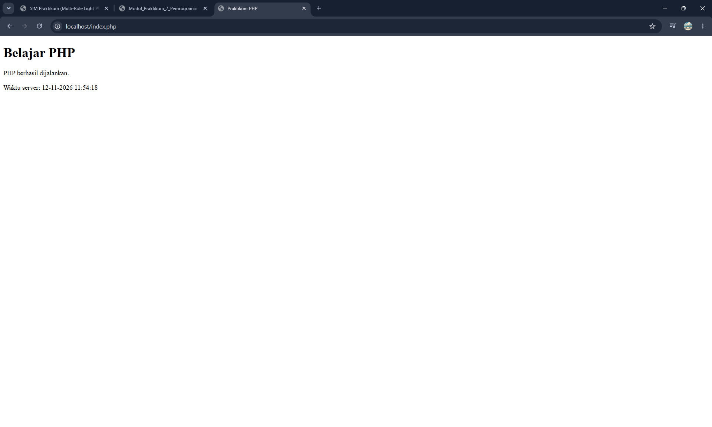
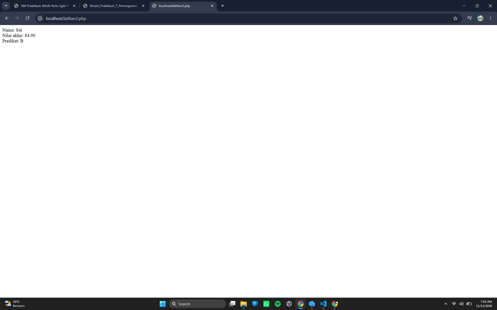
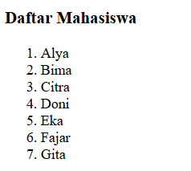
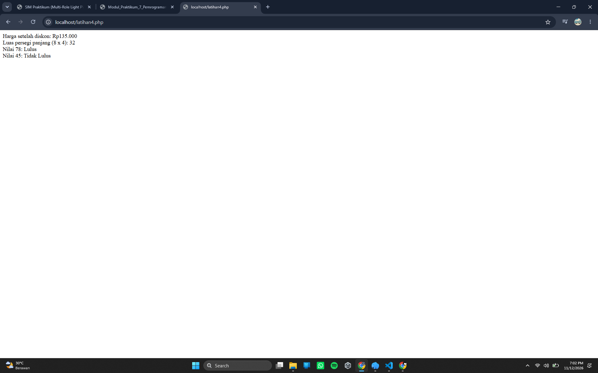
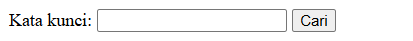
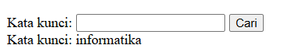
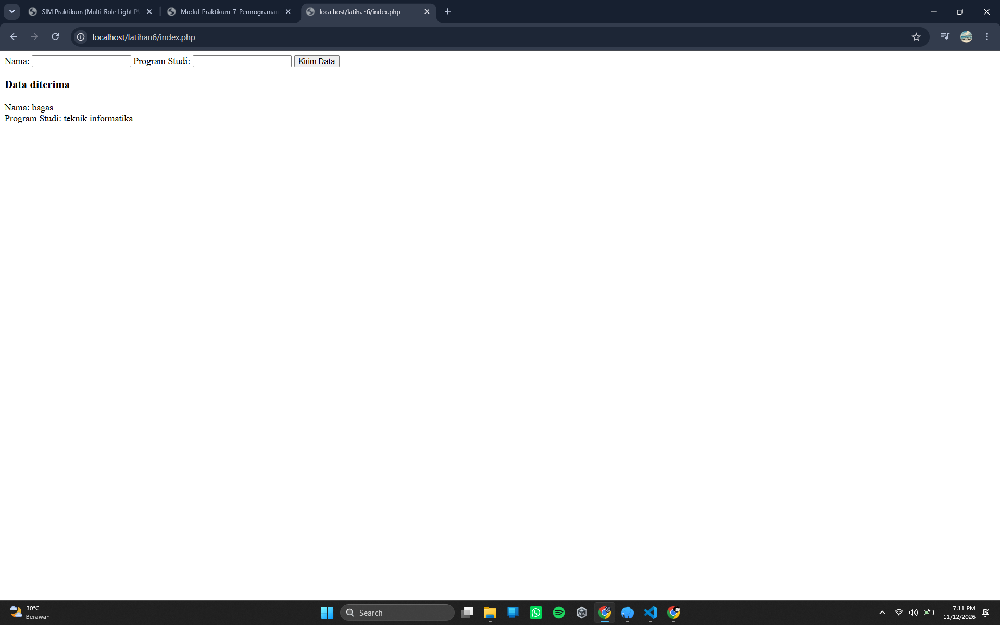
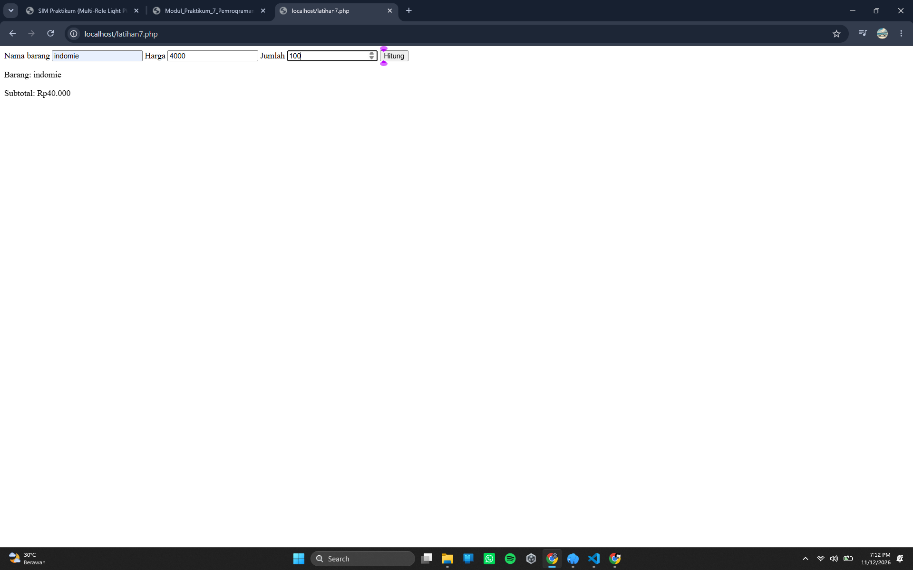
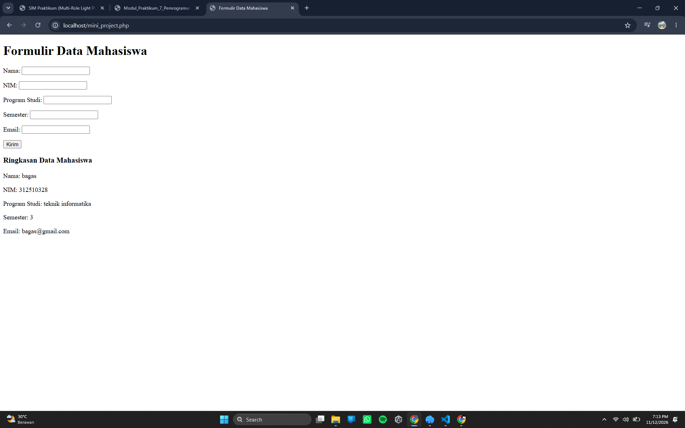

# Lab7Web_PHP  Praktikum 7: Pemrograman Server-Side dengan PHP

| Nama | Bagas Arya Ramadhan | 
| Nim |312510328 |
| Mata Kuliah | Pemrograman Web |  


## Struktur File
```
Lab7Web_PHP/
├── index.php            # Latihan 1–7 (satu halaman, dipisah per bagian)
├── mini_project.php     # Mini Project — Aplikasi Formulir Data Mahasiswa
├── eksperimen1.php      # Eksperimen 1 — Nilai rata-rata
├── eksperimen2.php      # Eksperimen 2 — Cari nama dari array dengan GET
├── eksperimen3.php      # Eksperimen 3 — Function format Rupiah
├── eksperimen4.php      # Eksperimen 4 — Validasi NIM
├── eksperimen5.php      # Eksperimen 5 — Tombol reset
├── screenshots/         # Screenshot output setiap latihan
└── README.md
```


### Latihan 1  Menjalankan PHP (`index.php`)


File `index.php` berisi HTML dengan blok PHP di dalamnya. Perintah `echo` mencetak teks dan `date("d-m-Y H:i:s")` mengambil waktu server. Browser menampilkan teks "PHP berhasil dijalankan." dan waktu server, bukan kode PHP, karena kode PHP dijalankan oleh server dan browser hanya menerima hasil HTML-nya. Ini membuktikan file dijalankan lewat web server (`http://localhost/Lab7Web_PHP/`).

### Latihan 2 Variabel, operator, dan percabangan (`index.php`)


Nilai akhir dihitung dengan bobot tugas 30%, UTS 30%, dan UAS 40%: (85 x 0,30) + (78 x 0,30) + (90 x 0,40) = 84,90. Struktur `if`, `elseif`, dan `else` menentukan predikat: nilai 84,90 berada di rentang >= 75 dan < 85, sehingga predikatnya B. `number_format()` membatasi tampilan dua angka desimal dan `htmlspecialchars()` mengamankan nama saat ditampilkan.

### Latihan 3  Perulangan dan array (`index.php`)


Array `$mahasiswa` berisi 7 nama (4 dari modul ditambah Eka, Fajar, dan Gita). Perulangan `foreach` menampilkan setiap nama sebagai item `<li>` dalam daftar bernomor `<ol>`.

### Latihan 4  Membuat function (`index.php`)


Function `hitungDiskon()` mengurangi harga dengan persentase potongan: 150.000 dengan diskon 10% menjadi Rp135.000. Dua function tambahan sesuai perintah modul adalah `hitungLuasPersegiPanjang()` (8 x 4 = 32) dan `tentukanKelulusan()` (nilai 78 "Lulus", nilai 45 "Tidak Lulus"). Function membuat kode bisa dipakai ulang dan lebih rapi.

### Latihan 5  Form dengan GET (`index.php`)



Setelah form dikirim, data ikut terbawa di URL, misalnya `index.php?kata=php`. Hal ini terlihat pada kolom alamat browser. Karena data terlihat di URL, GET tidak boleh dipakai untuk kata sandi atau data sensitif. Kata kunci ditampilkan kembali dengan `htmlspecialchars()`.

### Latihan 6  Form dengan POST (`index.php`)
Data lengkap:



Pada POST, data dikirim di body permintaan sehingga tidak tampil di URL. Server memeriksa kolom kosong dengan `trim()`; jika ada yang kosong, muncul "Semua kolom wajib diisi." Saat diuji dengan tag HTML seperti `<b>tes</b>` dan tanda kutip, teks tampil apa adanya dan tidak dieksekusi sebagai HTML, karena `htmlspecialchars()` mengubah karakter khusus menjadi entitas HTML.

### Latihan 7 Pengolahan data sederhana (`index.php`)
Input valid:




PHP memeriksa nama barang tidak kosong, harga berupa angka dan tidak negatif, serta jumlah berupa bilangan bulat minimal 1. Jika semua valid, subtotal = harga x jumlah, ditampilkan dengan `number_format()`. Jika tidak valid (misalnya jumlah 0, negatif, atau bukan angka), muncul pesan "Periksa kembali nama barang, harga, dan jumlah." Validasi HTML (`min`, `step`, `required`) hanya membantu pengguna; pemeriksaan utama tetap dilakukan PHP di server.

### Mini Project  Formulir Data Mahasiswa (`mini_project.php`)
Data valid:


Form menerima nama, NIM, program studi, semester, dan email dengan metode POST. Validasi di server memeriksa: nama, NIM, dan program studi wajib diisi; email harus berformat valid (`filter_var` dengan `FILTER_VALIDATE_EMAIL`); semester harus bilangan bulat 1–14 (`ctype_digit`). Semua pesan error ditampung dalam array dan ditampilkan sekaligus. Jika tidak ada error, ringkasan data ditampilkan dengan `htmlspecialchars()`. Bagian pemrosesan ada di atas file dan bagian tampilan HTML di bawahnya, sehingga keduanya terpisah.
